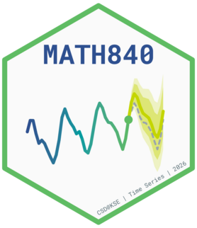
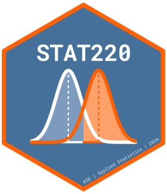
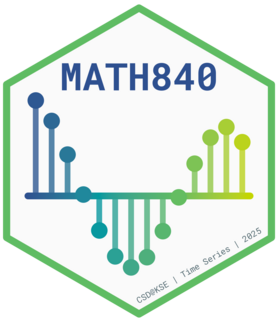
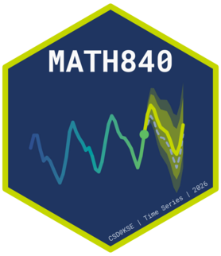
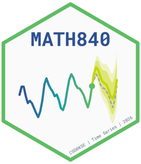
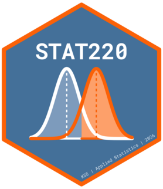

# KSE hex stickers

## R

<table>

<tr>

<td>

<br /><a href="logo/R/math840-25.png">math840-25.png</a>
</td>

<td>

<br /><a href="logo/R/math840-26-dark.png">math840-26-dark.png</a>
</td>

<td>

<br /><a href="logo/R/math840-26.png">math840-26.png</a>
</td>

<td>

<br /><a href="logo/R/stat150-25.png">stat150-25.png</a>
</td>

<td>

<br /><a href="logo/R/stat220-26.png">stat220-26.png</a>
</td>

</tr>

</table>

## Python

<table>

<tr>

<td>

<br /><a href="logo/python/math840-25.png">math840-25.png</a>
</td>

<td>

<br /><a href="logo/python/math840-26-dark.png">math840-26-dark.png</a>
</td>

<td>

<br /><a href="logo/python/math840-26.png">math840-26.png</a>
</td>

<td>

<br /><a href="logo/python/stat150-25.png">stat150-25.png</a>
</td>

<td>

<br /><a href="logo/python/stat220-26.png">stat220-26.png</a>
</td>

</tr>

</table>

## Usage

Every sticker has an R script in `R/` and an equivalent Python script in
`python/`; the shared generators are `R/hexsticker.R` and
`python/hexsticker.py`. They write `logo/R/<script name>.png` and
`logo/python/<script name>.png` respectively (43.9 × 50.8 mm, the
hexb.in / Posit size, at 1000 dpi). Render this README afterwards to
refresh `thumbs/` and the galleries.

**R** (packages pinned with renv):

``` sh
Rscript R/math840-26.R
```

**Python** (managed with [uv](https://docs.astral.sh/uv/); the only
dependency is matplotlib):

``` sh
uv run python/math840-26.py
uv run python/math840-26.py out/   # optional: write to another folder
```

The Python generator lives in `python/hexsticker.py`. Fonts are fetched
from Google Fonts once and cached in `.cache/fonts`.
